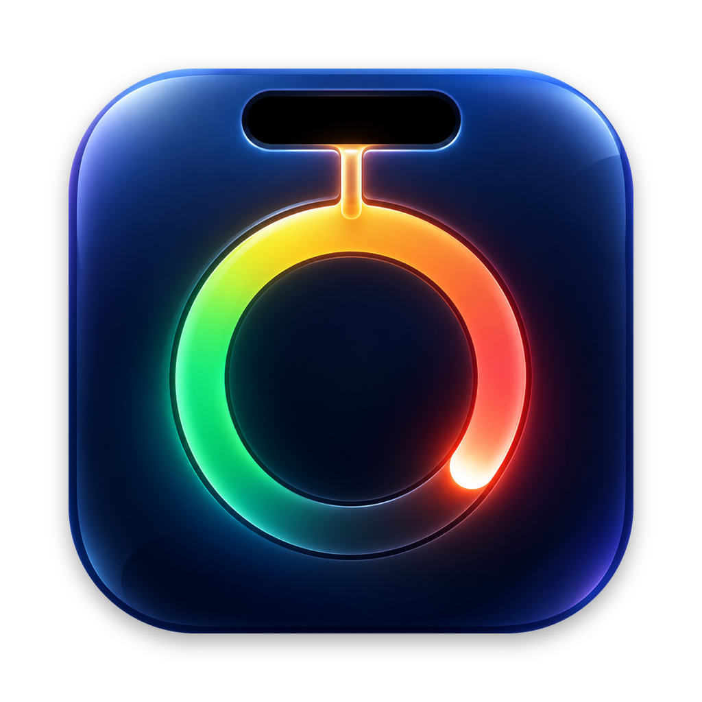

<p align="center">
  
</p>

<h1 align="center">Agentilo</h1>

<p align="center">
  Claude Code, Codex and Cursor plan limits, paced, beside your MacBook notch.<br>
  <a href="https://farvisun.github.io/agentilo/"><strong>Website</strong></a> ·
  <a href="https://github.com/farvisun/agentilo/releases/latest"><strong>Download</strong></a>
</p>

<p align="center">
  <a href="https://github.com/farvisun/agentilo/actions/workflows/ci.yml"></a>
  <a href="https://github.com/farvisun/agentilo/releases/latest"></a>
  
  <a href="LICENSE"></a>
</p>

Agentilo is a free, open-source notch app for macOS 14+. It shows how much of each plan window you have used, whether you are on pace to make it to the reset, and what your agents are doing right now, plus local token statistics. Everything it reads stays on your Mac.

## Install

1. Download `Agentilo.zip` from the [latest release](https://github.com/farvisun/agentilo/releases/latest), unzip it and move `Agentilo.app` to `/Applications`.
2. The app is ad-hoc signed, not notarized, so macOS blocks the first launch. Clear the quarantine flag once:
   ```sh
   xattr -dr com.apple.quarantine /Applications/Agentilo.app
   ```
   or right-click the app → Open, or allow it in System Settings → Privacy & Security.
3. Agentilo finds your agent homes (`~/.claude`, `~/.codex`, Cursor) on first launch. Hover the notch.

Or build it yourself: `git clone https://github.com/farvisun/agentilo && cd agentilo && make install`.

## Features

- **Collapsed**: ring + percentage of the most critical account, colored by pace.
- **Hover**: notch expands with session/weekly meters, reset times, pace ("On track", "Ahead of pace", "Runs out 7:24 PM"), live session row. Scroll or use arrows to page through accounts and the token stats page.
- **Alerts**: drop down out of the notch at 75%, 90% and 100% of a window (with the projected run-out time) and when a window resets. Optional sound. Settings → Alerts.
- **Local API + CLI**: `GET http://127.0.0.1:6737/v1/limits` (loopback only, refuses browser pages, no credentials) and `agentilo limits [--json|--short] [--force]` for scripts and status lines; falls back to cached numbers when the app is not running. Install the command in Settings → Agents.
- **Agents**: live list of running agents (working, waiting for approval or input, done) with the current tool and task, from [herdr](https://herdr.dev) and/or Claude Code / Codex hooks. A pulsing dot on the pill and a drop-down alert when an agent needs you or finishes a longer turn; click a row to jump to its herdr pane in Ghostty. Install hooks per home in Settings → Agents (commands marked `# agentilo`, other hooks untouched, original kept as `*.agentilo-bak`).
- **Approvals** (opt-in): Claude Code permission prompts appear in the notch with Allow / Deny / Always and the full command. Unanswered prompts go back to the terminal after a timeout (default 60s), as does any prompt for a herdr pane you are looking at. Settings → Agents → Approvals, then update the Claude hooks.
- **Activity**: a 26-week heatmap and streak, today's prompts, tool calls, sessions and top projects, and a cost estimate at Claude API list prices (plans are not billed per token; models without a known price are counted separately). Daily totals are kept in `daily-history.json`, so the heatmap outlives the agents' own 30-day log cleanup.
- **Accounts**: every agent home is its own account (`~/.claude`, `~/.claude_multi/*`, `~/.codex*`, Cursor). Auto-detected on first launch; edit in Settings → Accounts.
- **Proxy**: global System / None / HTTP / HTTPS / SOCKS5 with optional auth (password in Keychain), plus per-provider override and a connection test.

## Build from source

Needs Xcode 16 or later (Swift 6 toolchain).

```sh
make run        # build release, bundle build/Agentilo.app, ad-hoc sign, launch
make install    # copy to /Applications
make test       # unit tests
make dump       # print every account's limits and token stats in the terminal
```

## Data sources (read-only)

| Provider | Credential | Endpoint |
|---|---|---|
| Claude | Keychain `Claude Code-credentials[-<sha256(home)[:8]>]` or `<home>/.credentials.json` | `GET api.anthropic.com/api/oauth/usage` |
| Codex | `<home>/auth.json` | `GET chatgpt.com/backend-api/wham/usage` |
| Cursor | `state.vscdb` → `cursorAuth/accessToken` | `GET cursor.com/api/usage-summary` |

Tokens are never refreshed or rewritten and are only sent to their own provider. These endpoints are undocumented and may change.

### When the API is unavailable

If a provider rate limits the app, is unreachable, or the sign-in expired, the notch falls back to disk:

- **Codex**: every `token_count` event in `<home>/sessions/**/*.jsonl` carries `rate_limits` (used %, window, reset), so limits are exact as of the last Codex turn. Shown as "from Codex logs".
- **Claude**: Claude Code stores no limit percentages on disk. Each successful fetch records "% per cost-weighted token" for each window from the local logs; offline, the last response is advanced by tokens logged since, shown as "≈ estimated". Usage from other machines or claude.ai is not seen locally.
- Windows past their reset roll over to 0%. `make dump ARGS=--offline` prints the fallback without calling any server.

Token statistics come from `<home>/projects/**/*.jsonl` (Claude) and `<home>/sessions/**/*.jsonl` (Codex), deduplicated across files by message id, cached incrementally in `~/Library/Application Support/Agentilo/`.

## Privacy

- Credentials are read, never refreshed or rewritten, and only sent to the provider they belong to.
- No analytics, no telemetry, no account. The only network calls are the three usage endpoints above (through your proxy, if set).
- The local API binds to `127.0.0.1` only. See [SECURITY.md](SECURITY.md) to report a problem.

## License

[MIT](LICENSE). Provider logos are from [LobeHub Icons](https://github.com/lobehub/lobe-icons) (MIT) and are trademarks of their owners. Agentilo is not affiliated with Anthropic, OpenAI or Anysphere.
